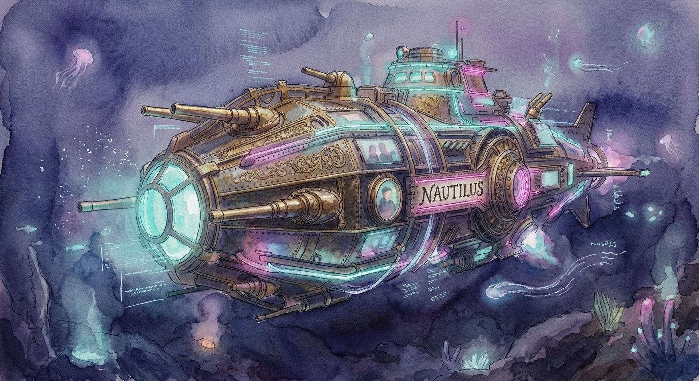

<p align="center">
  
</p>

# Nautilus

An [MCP](https://modelcontextprotocol.io) server that puts a Linux home server in reach of an AI
assistant — disks, memory, systemd, Docker, Radarr, Sonarr, Prowlarr, Jellyfin and Bazarr. And a
Telegram bot that asks it for you. Ask *"why hasn't Dune downloaded?"* instead of SSH-ing in.

## Lore

In Jules Verne's *Twenty Thousand Leagues Under the Sea*, the Nautilus is Captain Nemo's
submarine. From its salon he watches the sea through great windows, and on the walls of his room
hang the instruments he sails by — the manometer that gives the depth, the thermometer, the
compass, the log. This Nautilus reads a server the same way, below the surface a glance at it
shows: a disk out of inodes with bytes to spare, a container restarting every few seconds while
it reads as *running*, a download that finished and was never imported.

## Install

You need a Linux server with systemd and Docker. For the bot, a bot of your own from
[@BotFather](https://t.me/BotFather) and your numeric id from [@userinfobot](https://t.me/userinfobot);
for questions in plain words, an Anthropic API key from [platform.claude.com](https://platform.claude.com).

```sh
mkdir -p data   # the bot's files
curl -fsSL -o .env https://raw.githubusercontent.com/DeLucca990/Homelab-MCP/main/.env.example
chmod 600 .env   # NAUTILUS_HTTP_ADDR, NAUTILUS_HTTP_TOKEN, DOCKER_GID, the API keys, the bot's
```

A `compose.yml` beside it:

```yaml
services:
  nautilus-mcp:
    image: pedrodl/nautilus:latest
    container_name: nautilus-mcp
    env_file: .env
    network_mode: host
    pid: host
    user: "1000:1000"
    group_add: ["${DOCKER_GID}"]
    environment:
      - HOST_ROOT=/host
      - HOST_ETC=/host/etc
    volumes:
      - /:/host:ro,rslave
      - /var/run/docker.sock:/var/run/docker.sock
      - /run/dbus:/run/dbus:ro
      - /run/systemd/system:/run/systemd/system:ro
    read_only: true
    tmpfs: [/tmp]
    restart: unless-stopped

  nautilus-bot:
    image: pedrodl/nautilus:latest
    container_name: nautilus-bot
    command: ["/telegram-bot"]
    healthcheck:
      test: ["CMD", "/telegram-bot", "healthcheck"]
      start_period: 1m
    env_file: .env
    network_mode: host
    user: "1000:1000"
    volumes:
      - ./data:/data
    read_only: true
    tmpfs: [/tmp]
    restart: unless-stopped
```

```sh
docker compose up -d                          # start
docker compose pull && docker compose up -d   # update
```

The server is handed the host — its network, processes, filesystems read-only, the Docker socket
and the system bus — so it answers about the machine, not the container. The bot keeps its files
— the digest's history and what Claude has cost — in `data/`, as the folder's owner: `user:` is
`id -u`:`id -g`, 1000 for Ubuntu's first user. What each line is for, and moving from systemd:
[docs/INSTALL.md](docs/INSTALL.md).

## Using it

On **Telegram**, `/status`, `/disk`, `/docker`, `/logs jellyfin`, `/queue` and `/search dune`
call one tool each and cost nothing; `/help` lists the rest. Anything else goes to Claude with
every tool the server registered. The admins get a digest of the last day at 17:00.

From **Claude Code**, or any client that speaks MCP over HTTP:

```sh
claude mcp add --transport http nautilus http://100.101.102.103:3000/mcp \
  --header "Authorization: Bearer $NAUTILUS_HTTP_TOKEN"
```

Radarr, Sonarr, Prowlarr, Jellyfin and Bazarr appear only when their key is in the `.env`, and
container exec and restart only for the containers `NAUTILUS_ALLOW_CONTAINER_NAMES` names.
Nothing that changes the server — adding a film, restarting a container — runs before you approve
that exact operation: with **Aprovar** / **Recusar** buttons on Telegram, in the terminal in
Claude Code.

## More

- [docs/INSTALL.md](docs/INSTALL.md) — the Docker install: what the server is given and why, health, moving from systemd
- [docs/DETAILS.md](docs/DETAILS.md) — every setting, approvals, running from source and under systemd, tests
- [docs/tools/README.md](docs/tools/README.md) — every tool, prompt and resource
- [docs/modules/telegram.md](docs/modules/telegram.md) — the bot: commands, admins, the digest, spending
- [docs/ARCHITECTURE.md](docs/ARCHITECTURE.md) — how it is built
